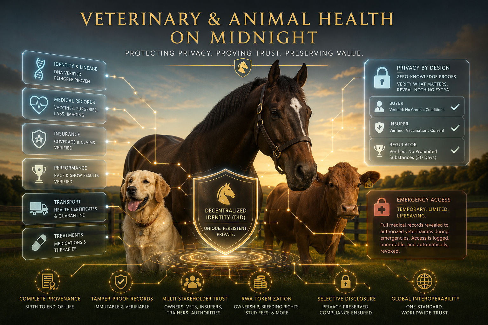

# SharedScience.me × Unbound Science × Health Data Repos

**Date**: March 23, 2026
**Author**: Cassie + John
**Source**: https://unboundscience.com/

---

## What Is Unbound Science?

Unbound Science bills itself as "The Next Technology Upgrade to Science Itself" — a decentralized platform for scientists and inventors to preserve, fund, and distribute their work. Key features:

- **Seed bank for tech** — immutable storage of blueprints and instruction manuals on blockchain
- **Subject-specific funding pools** — crowdfunding by problem domain (Energy, Air/Water/Soil, Pollution/Waste, Quantum)
- **Scientist identity protection** — shielding researchers from corporate/government retaliation
- **Technology licensing marketplace** — recurring revenue through licensing, consulting, leasing rights
- **Public participation** — community voting, peer review, governance
- **Global technology distribution** — connecting inventors with distribution platforms worldwide

Their mission page focuses on ending "artificial scarcity" across four sectors: Energy, Food, Waste Management, and Medicine.

---

## What Unbound Science Brings (That SharedScience Doesn't Have Yet)

| Unbound Science Feature | SharedScience Gap | Integration Opportunity |
|---|---|---|
| **Subject-Specific Funding Pools** (Energy, Health, Waste, Quantum) | SS has zero funding mechanism | **Solved by CareToCoin** — CTC already handles privacy-preserving donations, tax compliance, and milestone-linked disbursement. No standalone `funding-pool.compact` needed. See [CARETOCOIN_FUNDING_INTEGRATION.md](./CARETOCOIN_FUNDING_INTEGRATION.md) |
| **Immutable Research Preservation** ("seed bank for tech") | SS focuses on discovery, not preservation | Add a `research-vault.compact` — hash-anchored blueprints/manuals stored off-chain, existence proofs on-chain. Research can never be censored or lost |
| **Technology Licensing Marketplace** (licensing, consulting, leasing rights) | SS stops at collaboration agreements | Extend `collaboration-agreement.compact` with licensing terms, royalty splits, and recurring revenue structures |
| **Public Participation** (community voting, peer review, governance) | SS is org-to-org only | Add a `peer-review.compact` — anonymous peer review with ZK-verified domain expertise. Reviewers prove they're qualified without revealing identity |
| **Anti-Censorship Guarantee** | Not explicitly addressed | Midnight's private state already provides this — just needs to be framed and documented as a first-class feature |
| **Technology Distribution Network** (connecting inventors to distribution platforms) | SS has no commercialization layer | Add a `distribution-channel.compact` — verified manufacturers/distributors prove production capability, connect to inventors through the same capability-matching pattern |

---

## The Cross-Repo HIPAA Integration



All three health data repos already have the building blocks:

- **safeHealthData** — KYCz binding stack for HIPAA-grade patient identity, folder-based records
- **equineProData** — Workflow #8: "Research Marketplace — Opt-in cohort matching with micropayments"
- **petProData** — Workflow #7: Same research marketplace pattern, plus "One Health" bridge concept

**What's missing**: A cross-domain research coordination layer that lets researchers discover and access de-identified health data across all three platforms without breaking HIPAA.

### SharedScience Becomes That Layer

```
SharedScience.me (Research Coordination Layer)
├── Capability Registry ← researchers publish what they CAN study
├── Data Availability Registry ← NEW: health repos publish what data EXISTS
│   ├── safeHealthData → "We have 10,000+ de-identified cardiac records"
│   ├── equineProData → "We have 5,000+ equine joint pathology records"
│   └── petProData → "We have 8,000+ canine osteoarthritis records"
├── Cohort Matching Engine ← NEW: match researcher needs to available data
├── Consent Aggregator ← NEW: verify opt-in consent across repos via ZK
├── Funding Pools ← NEW (from Unbound): fund research by problem domain
└── SelectConnect Protocol ← progressive disclosure for all interactions
```

### New Contract: `data-availability-registry.compact`

A sibling to `capability-registry.compact` but for data providers instead of capability providers. Health repos publish ZK proofs of what aggregate data they hold:

- **Data domain** (cardiac, equine joint, canine osteoarthritis)
- **Volume range** (proves "more than N records" without revealing exact count)
- **De-identification level** (HIPAA Safe Harbor, Expert Determination, fully synthetic)
- **Consent status** (all subjects opted in to research marketplace)
- **Temporal range** (data collected within last N years)

Researchers search this registry the same way they search capability proofs. The progressive disclosure via SelectConnect applies: researcher proves credentials → data provider verifies IRB approval → consent is verified on-chain → data access granted under agreement terms.

### New Contract: `consent-aggregator.compact`

Bridges the "Research Consent" folders that already exist in safeHealthData, equineProData, and petProData:

- Verifies every subject in a cohort has an active opt-in
- Proves aggregate consent without revealing individual identities
- Tracks micropayment obligations back to data subjects
- Enables revocation that cascades across active research agreements

### The "One Health" Bridge

PetProData already documents this concept — human, animal, and environmental health are interconnected. SharedScience becomes the neutral ground where:

- A zoonotic disease researcher discovers relevant data exists across both safeHealthData and petProData
- A veterinary drug researcher finds human clinical trial parallels in safeHealthData
- An equine therapy researcher proves patient outcomes without exposing patient identity (via safeHealthData) or horse medical history (via equineProData)

All through ZK proofs. No one sees raw data until consent, credentials, and agreements are verified on-chain.

---

## DemoLand Auth Standard Notes

Per the PixyPi demoLand Auth Standard (March 2026):

- SharedScience needs a **port assignment**: suggest `3014` with `NEXT_PUBLIC_SS_MODE`
- The `frontend-demoland/` directory needs the **7-method auth standard**
- Should be added to the ecosystem audit table

---

## Recommended Phasing

### Phase 1 (Now): Documentation + Architecture
- Add this doc and HIPAA cross-repo data sharing doc
- Expand domain taxonomy to include Unbound's 4 sectors (Energy, Food/Agriculture, Waste Management, Medicine)
- Assign port 3014 and add to demoLand auth audit

### Phase 2: Core New Contracts
- `data-availability-registry.compact` — data provider counterpart to capability-registry
- `consent-aggregator.compact` — cross-repo consent verification
- Extend `collaboration-agreement.compact` with licensing/royalty terms
- **CareToCoin integration** — milestone-linked disbursement bridge (replaces standalone `funding-pool.compact`)

### Phase 3: Unbound Science Features
- `research-vault.compact` — immutable research preservation
- `peer-review.compact` — anonymous qualified peer review

### Phase 4: Distribution & Commercialization
- Distribution channel contract
- Public participation / governance layer

---

*Pinned for later. — Cassie + John, March 23, 2026*
